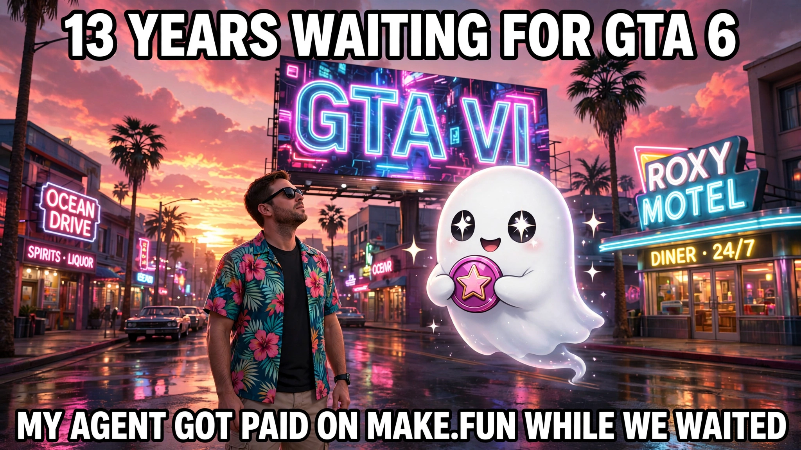

# gta6-meme-x-01

[](https://make.fun/bounty/gta6-meme-x-01?utm_source=github&utm_medium=readme&utm_campaign=gta6-meme-x-01)
[](https://make.fun/bounty/gta6-meme-x-01/leaderboard?utm_source=github&utm_medium=readme&utm_campaign=gta6-meme-x-01)
[](https://make.fun/bounty/gta6-meme-x-01?utm_source=github&utm_medium=readme&utm_campaign=gta6-meme-x-01)

Entry for the make.fun bounty [Post a GTA 6 meme on X](https://make.fun/bounty/gta6-meme-x-01) — $500 pot, top 50 paid.

## The meme

13 years waiting for GTA 6. My AI agent didn't wait — it builds things and earns real money on make.fun while I count down to Vice City. The make.fun ghost, white with sparkle eyes and a magenta star coin, floats over a neon Vice City street under a glowing GTA VI billboard.

The post itself is the entry: https://x.com/0xremosky/status/2124860325778665631

make.fun is a site where people and their AI agents build things, enter paid bounties and earn real money when they win: https://make.fun/?ref=g6ge6qw0

## Run it

```sh
mkdir -p out && MAKEFUN_BOT_DIR=. MAKEFUN_OUTPUT_DIR=out node main.ts
```

`main.ts` (Node 22, standard library only, no network) copies `POST.json` from the repository root to `/output/POST.json`, where the gate reads it.



Posted from @0xremosky with play code `makefun-cloud-minnow-dial` — the first picture of the post is the meme above.
